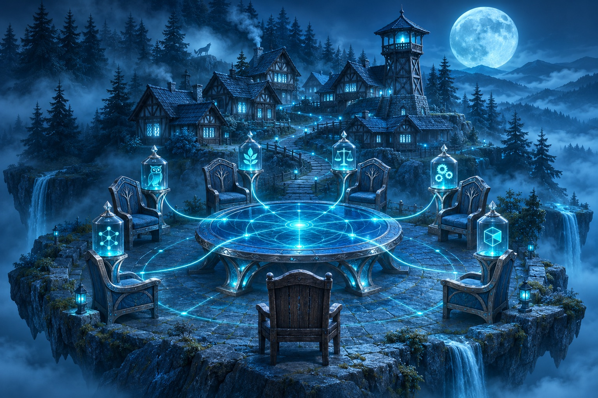

# Hi, I'm Muthukumar 👋

**Senior AI Engineer at Singtel · Singapore**

I build intelligent systems, thoughtful interfaces, and tools that make developers' lives easier. I joined Singtel on **12 October 2026**, bringing **15 years of software engineering experience** across frontend platforms, enterprise applications, and developer tooling.

My work now connects that foundation with agentic AI: orchestration, retrieval, memory, tool use, evaluation, and human decisions.

[Explore my interactive portfolio](https://mk-tdev.github.io/mk-tdev/) · [LinkedIn](https://www.linkedin.com/in/muthukumar-dev/) · [Email](mailto:muthukumar-a@outlook.com)

## What I work on

- **AI systems:** multi-agent workflows, MCP tools, RAG, bounded context, and inspectable decisions.
- **Product engineering:** React, Next.js, TypeScript, microfrontends, and interactive 3D experiences.
- **Developer tools:** browser extensions, native macOS utilities, log inspection, and network debugging.
- **Reliable delivery:** specification-driven development, behavioral testing, observability, and cloud services.

## Featured: Village of Shadows

**A playable multi-agent AI learning lab where the learner sits inside the graph.**

A seven-seat game of Werewolf with independent AI agents and human participation. Each AI seat has its own personality, private context, memory, and tools. Play a role, inspect the orchestration in God Mode, then replay decisions and explore the learning debrief.

Built with **LangGraph, MCP, FastAPI, Next.js, and PostgreSQL**.

[Enter the village](https://village-of-shadows.vercel.app/) · [Project overview](https://village-of-shadows.vercel.app/presentation) · [Source](https://github.com/mk-tdev/village-of-shadows)

## Developer tools & everyday apps

| Project | What it does |
| --- | --- |
| [Nori](https://github.com/mk-tdev/nori) | A native SwiftUI dashboard for Mac system metrics, apps, Docker, and developer caches. |
| [Logview Local](https://github.com/mk-tdev/logview) | A local browser console for inspecting Node.js logs and structured values while keeping existing `console.log()` calls. |
| [ScreenStitcher](https://github.com/mk-tdev/ScreenStitcher) | Capture visible areas or full webpages and export individual or collected screenshots as PDFs. |
| [TrafficLens](https://github.com/mk-tdev/TrafficLens) | Capture browser network requests and responses, then export JSON or a Postman Collection. |
| [StreakPath](https://play.google.com/store/apps/details?id=com.mktdev.streakpath) | An Android habit tracker for building and following daily routines. |

<strong>Hackathon lab — explore five projects</strong>

### BatchLens
An agentic quality investigator inside a playable factory. Follow evidence, compare hypotheses, and review inspection missions. Built for **AI Builder Cup 2026**.

[Live factory](https://batchlens-hk3hxwi5na-as.a.run.app/) · [Source](https://github.com/mk-tdev/BatchLens)

### Why That Goal?
An interactive football companion that connects synthetic match events, 3D replays, and explanations grounded in pitch evidence. Built for **Microsoft and the Premier League's Inside the Game hackathon**.

[Live demo](https://why-that-goal.blacksand-18241469.southeastasia.azurecontainerapps.io) · [Source](https://github.com/mk-tdev/why-that-goal)

### Heatline
Worker-first heat-safety planning, multilingual warnings, and a 3D rehearsal site for exploring shift decisions. A prototype for the **Future Health Digital Innovation Challenge**.

[Live demo](https://heatline-plum.vercel.app/) · [Source](https://github.com/mk-tdev/heatline)

### CrisisCraft
Coordinate an AI flood-response crew with bounded knowledge, approve plans, and rewind a decision to compare possible futures. Built during the **Meta Global AI Developer Hackathon**.

[Live demo](https://crisiscraft.vercel.app/) · [Source](https://github.com/mk-tdev/crisiscraft)

### Shift & Sip
A 3D café run by AI agents, with tools, guardrails, and a view into the teamwork behind each order. A buildathon adaptation of a multi-agent teaching platform.

[Live café](https://shift-and-sip-lab.mkumar-mtech15.chatgpt.site) · [Project story](https://shift-and-sip-lab.mkumar-mtech15.chatgpt.site/presentation)

## Toolbox

| Area | Technologies I work with |
| --- | --- |
| AI engineering | LangGraph, LangChain, OpenAI Agents SDK, MCP, RAG |
| Interfaces | TypeScript, React, Next.js, Angular, Vue, Three.js, Babylon.js |
| Services & data | Python, FastAPI, Node.js, PostgreSQL |
| Native apps | Swift, SwiftUI |
| Cloud & delivery | AWS, Azure, Google Cloud, Docker, Kubernetes, GitHub Actions |
| Quality | Playwright, Jest, React Testing Library |

**AWS Certified Solutions Architect – Associate**

## Exploring next

- Agent evaluation, context boundaries, and evidence-backed decisions.
- Specification-driven, AI-assisted software delivery.
- Playable simulations that make complex systems easier to understand.

[Portfolio](https://mk-tdev.github.io/mk-tdev/) · [LinkedIn](https://www.linkedin.com/in/muthukumar-dev/) · [YouTube](https://www.youtube.com/channel/UCO8OwLWlAIQU4kYWLytkEVw)
